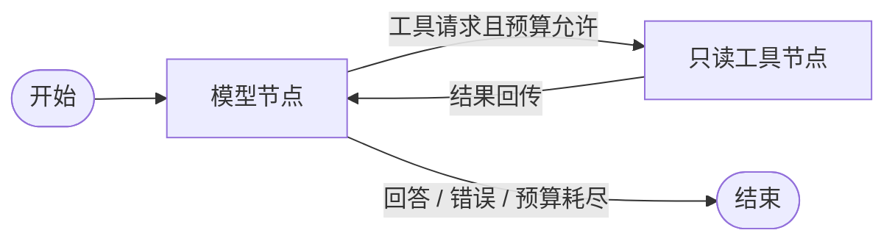

# 知码 · CodeTrace

基于 **LangGraph StateGraph** 的只读代码仓库分析助手。定位是通过搜索和阅读源码，输出带文件路径与行号的回答。

这是一个新建的 Python 项目。主执行链不使用 OpenManus，也不导入 `../backup` 中的代码。旧项目保留在工作区的 `backup` 目录，用于学习参考。本项目尚未添加发布许可证。

## 当前能力和边界

- 真正使用 LangGraph 编排 `model → tools → model`，通过条件边结束任务。
- 三个只读工具：列出源码文件、字面量搜索、按行读取 UTF-8 文件。
- 拒绝路径越界、符号链接与 Windows reparse point；过滤常见依赖目录和凭证文件名，限制扫描、文件大小和返回量。
- 限制模型轮数及工具调用次数；工具错误回传模型，模型失败、超时和预算耗尽有明确停止原因。
- 回答使用 `[[app.py:L4-L6]]` 格式引用。检查该范围是否包含在本次实际读取记录内；保存读取片段和文件 SHA-256。
- 可选择把消息、工具结果、耗时、模型返回的 usage 和停止原因保存为本地 JSON。
- 无 API Key 时提供固定离线演示；联网模式提供 OpenAI 兼容接口适配层。

**离线模式是固定工具调用演示，不能自由回答问题。真实模型接口尚未验证。** 标准引用的范围有效不代表结论语义正确；没有引用的回答也不会因此自动成为有证据的结论。当前无持久化检查点、任务恢复、向量检索、数据库、Web 服务或多 Agent。

路径防护针对正常的本地仓库，不是操作系统安全沙盒。不要分析被其他进程恶意并发修改的目录。文件名过滤不能发现所有写在普通源码中的密钥。联网模式会把读取内容发送给你配置的模型服务，执行记录也包含源码；仅分析有权发送的代码。

## 环境准备

在项目根目录使用 PowerShell，安装 Python 3.12 后执行：

```powershell
py -3.12 -m venv .venv
.\.venv\Scripts\python.exe -m pip install -e ".[dev]"
```

依赖安装需要联网。运行时不依赖 Docker、Node.js、GPU、浏览器或旧项目虚拟环境，也不需要开通 LangSmith。LangGraph 以本地 Python 库运行。

`requirements-lock.txt` 记录本次验证环境的精确依赖版本（Windows / Python 3.12.10，含测试依赖）。要复现该组合，可先安装快照，再以可编辑模式安装项目：

```powershell
.\.venv\Scripts\python.exe -m pip install -r requirements-lock.txt
.\.venv\Scripts\python.exe -m pip install --no-deps -e .
```

## 先运行离线演示

```powershell
.\.venv\Scripts\python.exe -X utf8 -m codetrace --repo examples/demo_repo --offline --trace-dir runs
```

固定流程是：列文件 → 搜索 `def main(` → 读取匹配片段 → 输出引用。演示不会导入或执行被分析仓库的源码。预期停止原因是 `completed`，模型轮数 4，工具调用 3，回答含 `[[app.py:L4-L10]]`。

可将 `--repo` 换成其他仓库，但离线模式仍只演示查找 `def main(`，不能模拟真实问题理解。它也不会加载 `.env`。

## 接入国内模型（待实际验证）

复制 `.env.example` 为 `.env`，填写本地密钥、接口根地址和模型名：

```dotenv
CODETRACE_API_KEY=在本地填写
CODETRACE_BASE_URL=https://api.deepseek.com
CODETRACE_MODEL=deepseek-chat
```

示例值不是本项目的可用性测试结果；以模型服务商当前文档为准。其他 OpenAI 兼容服务也可配置，模型必须支持 `tools`。`.env` 已被 Git 忽略。命令从项目根目录运行，配置只从当前工作目录读取，不会自动读取目标仓库中的 `.env`。

```powershell
.\.venv\Scripts\python.exe -X utf8 -m codetrace --repo examples/demo_repo --question "main 如何调用 greet？请读取相关代码并引用。" --trace-dir runs
```

默认最多 8 轮模型决策、16 次工具调用，单轮模型节点超时 90 秒。SDK 请求超时 45 秒且最多重试一次。可用 `--max-rounds`、`--max-tools` 调整执行预算。模型费用由实际调用产生，usage 仅记录服务端返回值，不预估成本或捏造节省比例。

## 如何阅读源码

```text
src/codetrace/cli.py          读取参数、选模型、展示结果、保存记录
src/codetrace/graph.py        状态定义、两个节点、条件边、终止原因、引用核验
src/codetrace/models.py       离线模型和 OpenAI 兼容模型接口
src/codetrace/repository.py   三个只读工具和访问范围限制
examples/demo_repo/          可重复验证的小型仓库
tests/                       工具边界与图流程测试
```

推荐先看 `graph.py` 的 `build_graph()` 和 `analyse()`，再看 `repository.py`。每次调用使用独立图状态；没有把旧 Agent 的 while 循环包在图节点里。



## 测试

```powershell
.\.venv\Scripts\python.exe -m pytest -q
.\.venv\Scripts\python.exe -m pip check
```

测试使用临时仓库和模拟模型，不调用收费模型接口。Windows 无符号链接创建权限时，对应测试会跳过，其他测试继续执行。

2026-10-20 本地验证：**26 passed, 1 skipped**（符号链接创建权限不足）；离线 CLI 演示和 `pip check` 通过。SDK 适配层通过模拟 HTTP 响应验证工具调用与 usage 解析，未连接真实模型服务。

## 后续开发

1. 接入一个真实国内模型，收集入口定位、跨文件调用和无法回答的问题。
2. 建立人工标注评测集，分别衡量检索命中、引用有效、语义正确和调用成本。
3. 扩展引用核验与回答生成策略，测试无引用、伪造引用和证据不足场景。
4. 根据需求添加重复调用检测、上下文压缩和检查点；需要恢复任务时再选持久化存储。

部署与演示命令以本 README 为准；工作区外层的早期方案描述的是旧 OpenManus 方案。
