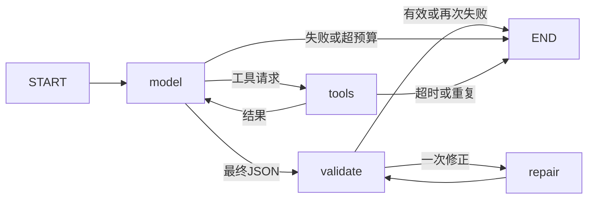

# 执行状态与工具契约

主流程由 LangGraph StateGraph 的 model、tools、validate、repair 四个节点组成：

schema_version=1 的结果契约与样例见 [RESULTS.md](RESULTS.md) 和 [answer-examples.json](answer-examples.json)。旧版任意非空文本 completed 已移除。validate 检查结构及本次 evidence_id、路径、行号；repair 最多一次且禁用工具，也计入请求预算。insufficient_evidence 与 completed 分开统计。引用检查不证明语义正确。

状态包含完整消息、rounds（有效模型响应数）、model_attempts（请求尝试数）、tool_count、repair_count、证据、调用历史和 trace。无持久化检查点；每次 analyse 创建独立图和 run_id。read_file 返回内容快照及SHA-256，登记后向模型返回任务内 evidence_id。相同片段去重，文件变化产生新证据。

默认最多8次模型请求、16次工具调用、单次模型90秒、任务总计180秒、输入60000字符。修正受相同预算限制。上下文计入消息与工具定义，不静默删除工具协议消息。字符数不是计费token。工具批次超预算整批跳过，每个call_id仍有工具响应。总时限后不再调度新操作，不保证硬取消操作系统中阻塞的文件线程。

相同工具与规范化参数连续重复时，比对有界仓库内容指纹及结果；第二次无新增信息时提醒，第三次相同且仓库未变化时停止。内容或参数变化允许继续。指纹检查本身也消耗时间，仅适用于当前小型本地仓库；不是增量索引。异常只记录类型，不保存供应商异常正文。

工具契约见 [TOOLS.md](TOOLS.md)。系统无Shell、Python执行、文件写入工具，仓库文本不能改变工具授权。仓库路径保护不是针对恶意并发修改的OS沙盒。仅用户明确请求保存trace时输出任务记录，其中包含源码。
